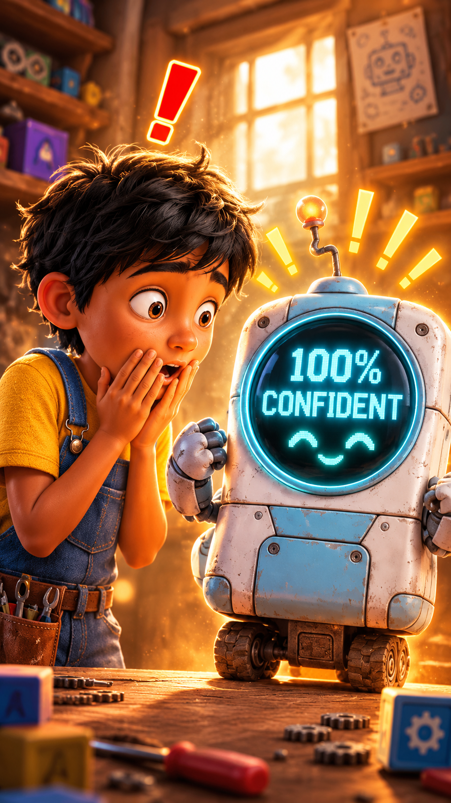

# Day 5: The Robot That Almost Won the Science Fair

**Concept:** AI hallucination: answers that sound right but are made up.
**Length:** ~2:37 · 
**Format:** 9:16 animated story
**Watch:** [LinkedIn](https://lnkd.in/p/d7qkECKj) · [Instagram](https://www.instagram.com/reel/DgKex1Ghqdj/?gwpx=d21xbDJtcnc5bTM0) · [YouTube Short](https://youtube.com/shorts/CSg5i3OHlL8)

## Takeaway
Draft with AI. Verify before you trust.

## Files
| File | What it is |
|------|------------|
| 01-story.md | Full story |
| 02-video-script.md | Scene-by-scene script |
| 03-visual-prompts.md | AI image/video prompts |
| 04-voiceover.md | Voiceover lines |
| 05-captions/ | Platform copy |
| 06-thumbnail.md | Thumbnail concept |
| 07-quiz.md | 3-question quiz |
